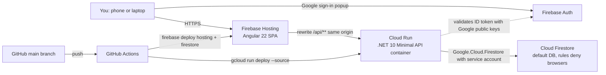

# NAMA PRD

<aside>
📌

**TL;DR**

- **What:** **NAMA**, a personal web app to plan and track spending per category and sub-category across a fiscal year, using salary-to-salary months.
- **Stack:** Angular 22 on Firebase Hosting, `ASP.NET` Core (.NET 10) API on Cloud Run in one small Docker container, Cloud Firestore, Google sign-in through Firebase Auth, and GitHub Actions deploying every push on `main` straight to production.
- **Phase 1:** setup wizard, sub-category plan, daily input with a planned indicator, entries table, months view with a compact year view, settings, and a tiny dashboard preview. **Phase 2:** full dashboard (placeholder only).
- Everything I added is tagged **🆕 ADDED**. Untagged items are your requirements. Your answers from 17 Oct 2026 are tagged **✅ DECIDED**.
</aside>

## ▶️ Start here: how Claude Code builds NAMA

<aside>
🛑

**Golden rule:** this PRD is the only source of scope. If it is not written here, Claude does not build it. If something is unclear, missing or contradictory, Claude stops and asks before writing code.

</aside>

### Step 1. Prepare the repo (you, about 10 minutes)

1. Create an empty GitHub repo named `nama` and open it in VS Code.
2. Export this page as Markdown and save it as `docs/PRD.md`.
3. Copy Appendix A into `CLAUDE.md` at the repo root. Claude Code loads it automatically every session ([Claude Code docs](https://docs.claude.com/en/docs/claude-code/memory)).
4. Create `docs/PROGRESS.md` with three headings: Status, Decisions, Open questions. Claude reads it at the start of every session and updates it at the end.

### Step 2. First session: questions only, no code

Turn on plan mode (in the terminal: Shift+Tab until the status bar shows plan mode, or start with `claude --permission-mode plan`). In plan mode Claude reads and plans but does not edit. Anthropic recommends exploring and planning before coding, because jumping straight to code can solve the wrong problem ([best practices](https://code.claude.com/docs/en/best-practices)). Paste this:

```
Read CLAUDE.md and docs/PRD.md completely. Do not create or change any files.
Reply with:
1. Every point that is ambiguous, missing or contradictory, with its section or requirement ID.
2. Every assumption you would have to make.
3. Every package, version and CLI command you plan to use, and the official doc you will check for each.
4. Your plan for milestone M0 only: files to create and how you will prove each "Done when" check.
Then stop and wait for my answers.
```

Answer its questions. Claude records each answer under Decisions in `docs/PROGRESS.md`.

### Step 3. The loop for every milestone (M0 to M9, in order)

1. **Fresh session per milestone** (`/clear`). Claude's quality drops as its context fills up, so never run several milestones in one session.
2. **Plan in plan mode:** Claude lists the requirement IDs it covers, the files it will touch, the tests it will add, and its questions. You review and approve (Ctrl+G opens the plan in your editor if you want to change it).
3. **Tests first** for every rule in section 4.
4. **Build exactly the approved plan.** Nothing extra.
5. **Prove it:** run `dotnet test`, `npm run build` and the milestone's "Done when" checks, and paste the real output.
6. **Commit and push** with requirement IDs in the message (this deploys to production), then update `docs/PROGRESS.md`.

### Step 4. Rules against hallucination and scope creep

- No features, screens, fields, endpoints, libraries or settings beyond this PRD. New ideas go to Open questions in `docs/PROGRESS.md`, not into code.
- Never invent package names, versions, APIs, config keys or CLI flags. Check the official docs or the package README first. The code sketches in sections 7.8 to 7.10 are starting points to verify, not facts.
- When a build or test fails, show the error and fix the cause. Never weaken tests, skip checks or silence errors to get green.
- Read a file before editing it. Keep changes small. No unrelated refactors, renames or reformatting.
- Never say "done" or "works" without command output that proves it.
- Never change cloud settings or production data, and never run `infra/setup.sh`. You do those by hand.
- A new dependency needs a one-line reason and your approval first.

### Prompts to copy

```
SESSION START
Read CLAUDE.md, docs/PRD.md and docs/PROGRESS.md. We are doing milestone M_ only.
In plan mode, list: requirement IDs covered, files to change, tests to add, open questions.
Do not edit any files yet.

AFTER YOU APPROVE THE PLAN
Implement the approved plan only. Then run dotnet test and npm run build, paste the output,
go through the milestone's "Done when" list one by one, and update docs/PROGRESS.md.

IF IT DRIFTS
Stop. That is not in the approved plan or the PRD. Undo it and continue with the plan.
```

---

## 0. How to read and use this PRD

### Legend

- **No tag** = your requirement.
- **🆕 ADDED · Must** = I added it because the app breaks, or shows wrong numbers, without it.
- **🆕 ADDED · Nice** = optional, safe to drop if time is short.
- **🆕 ADDED · Tech** = implementation choice that keeps the build simple, fast and safe.
- **✅ DECIDED** = you chose this when I asked.

### Quick reference (the full method is in "Start here" above)

1. Export this page as Markdown and save it in the repo as `docs/PRD.md`. It is the source of truth.
2. Copy Appendix A into `CLAUDE.md` at the repo root. Claude Code loads the project `CLAUDE.md` automatically at the start of each session ([Claude Code docs](https://docs.claude.com/en/docs/claude-code/memory)).
3. Build one milestone at a time (section 8). Ask Claude to plan first, then implement, then run that milestone's "Done when" checks.
4. Requirement IDs (for example `ENT-03`) never change. Use them in prompts and commit messages.
5. The research and benchmark behind these choices are in the child page **Research & Benchmark** at the bottom of this page.

---

## 1. Context and goals

**Problem.** Spending is hard to control without a plan per category and a quick way to log each spend against that plan.

**Goal.** Track spending across a selected fiscal year. Every spend is categorized (category → sub-category) and compared with the planned amount for its month.

### Success criteria 🆕 ADDED · Nice

- Logging a spend on a phone takes under 10 seconds (category, sub-category, amount, save).
- For any month you can see planned, spent and remaining at a glance.
- Warm API calls feel instant (target under 300 ms).
- Running cost stays at about 0 USD per month for personal use, protected by a budget alert.

### Users

- One user (you). Data is stored per Google account, so the app is multi-user ready, but admins and invite links limit who can use it (`AUTH-02`).

### Out of scope for Phase 1

- Bank syncing, SMS parsing, receipt scanning.
- Multiple currencies or currency conversion.
- Shared budgets or several people editing the same data.
- Native mobile apps (the web app is responsive and can be installed as a PWA, `UX-06`).
- Arabic and right-to-left layout (English UI only in Phase 1). ✅ DECIDED
- Recurring or scheduled transactions, notifications.
- The full dashboard (Phase 2).
- Deleting categories, sub-categories or bank accounts (your rule).

---

## 2. Decisions log

| # | Topic | Decision | Why (with source) | Tag |
| --- | --- | --- | --- | --- |
| 1 | Hosting | Angular on Firebase Hosting. The .NET API runs on Cloud Run and is reached through a Hosting rewrite of `/api/**` | Cloud Functions for Firebase only supports Node.js and Python, so .NET must run on Cloud Run, which Hosting can route to. Same origin means no CORS setup. [Hosting + Cloud Run](https://firebase.google.com/docs/hosting/cloud-run), [Functions languages](https://firebase.google.com/docs/reference/functions) | ✅ DECIDED |
| 2 | Firebase plan | Blaze (billing card linked) plus a budget alert | Cloud Run needs a Cloud Billing account even inside its free quota; linking billing moves the project from Spark to Blaze. [Hosting + Cloud Run](https://firebase.google.com/docs/hosting/cloud-run) | ✅ DECIDED |
| 3 | Database | Cloud Firestore, Native mode, the default database, accessed only by the API | Firebase-native. Free quota of 50,000 reads and 20,000 writes per day, for one database per project. [Firestore billing](https://firebase.google.com/docs/firestore/pricing) | 🆕 ADDED · Tech |
| 4 | Month cycle | A month runs from payday to the day before the next payday and is named by the month the salary arrives. Payday is set in the wizard and can be changed in Settings | Matches salary-to-salary spending. Worked example in section 3. Confirmed on 17 Oct 2026 | ✅ DECIDED |
| 5 | Bank account on entries | Required on every entry, defaults to the last used account | No extra tap, and better data for Phase 2 | ✅ DECIDED |
| 6 | Closed months | Status is automatic by date; closed months stay editable | Mistakes can be fixed later | ✅ DECIDED |
| 7 | Backend version | .NET 10 (LTS, supported until 14 Nov 2028), `ASP.NET` Core Minimal API | .NET 8 and .NET 9 both reach end of support on 10 Nov 2026. [.NET support policy](https://dotnet.microsoft.com/platform/support/policy) | 🆕 ADDED · Tech |
| 8 | Frontend | Angular 22 + Angular Material. Plain Firebase JS SDK for sign-in, no AngularFire | Angular 22 shipped on 3 Jun 2026. AngularFire had an open request for Angular 22 support, so the plain SDK avoids being blocked. [Angular v22](https://blog.angular.dev/announcing-angular-v22-c52bb83a4664), [AngularFire issue 3737](https://github.com/angular/angularfire/issues/3737) | 🆕 ADDED · Tech |
| 9 | Docker | Yes, one small multi-stage Dockerfile for the API only | Cloud Run runs containers. Details in 7.8 | 🆕 ADDED · Tech |
| 10 | Sign-in | Google sign-in with the Firebase Auth popup. The API validates the Firebase ID token itself | Popup is one of Firebase's listed fixes for browsers that block third-party storage. [Redirect best practices](https://firebase.google.com/docs/auth/web/redirect-best-practices), [Verify ID tokens](https://firebase.google.com/docs/auth/admin/verify-id-tokens) | 🆕 ADDED · Tech |
| 11 | CI/CD | One GitHub Actions workflow: push to `main` → test → build → deploy API → deploy Hosting and rules → smoke test | Production is the only environment, as you asked | 🆕 ADDED · Tech |
| 12 | Region | `me-central1` (Doha) for both Cloud Run and Firestore | Closest Google region with no extra contract: Google has no Bahrain region, and Dammam needs CNTXT or invoiced billing ([Dammam access](https://cloud.google.com/docs/dammam-region-access)). Supported for Hosting rewrites and Firestore. Firestore location cannot be changed after creation. [Hosting + Cloud Run](https://firebase.google.com/docs/hosting/cloud-run), [Firestore locations](https://cloud.google.com/firestore/docs/locations) | ✅ DECIDED |

---

## 3. Glossary

- **Fiscal year (FY):** 12 consecutive months, starting with the month you choose (for example January or July).
- **Month (period):** one payday cycle. It starts on payday and ends the day before the next payday. It is named by the month the salary arrives. In code it is a *period* with a key like `2026-09`.
- **Payday:** the day of the month your salary arrives (1 to 31). Payday 1 gives normal calendar months.
- **Category:** a top-level group you create, for example Food.
- **Sub-category:** belongs to exactly one category, for example Food → Groceries. Planned amounts are set at this level.
- **Plan:** the planned amount for one sub-category in one month.
- **Entry:** one spend: date, sub-category, amount, bank account, optional note.
- **Income:** salary (one value per month, with history) plus additional income items. **Total income = salary + additional income.**
- **Status:** Closed, In progress, or Yet to come.

<aside>
🧮

**Worked example (also used as a unit test).** Payday = 27, FY start = January, today = 17 Oct 2026.

- Month "Sep 2026" = 27 Sep 2026 to 26 Oct 2026, funded by the salary received on 27 Sep.
- On 17 Oct 2026: Sep 2026 is **In progress**, Aug 2026 is **Closed**, Oct 2026 (27 Oct to 26 Nov) is **Yet to come**.
- FY 2026 = 27 Jan 2026 to 26 Jan 2027: 12 months labeled Jan 2026 to Dec 2026.
</aside>

---

## 4. Business rules

These are the rules Claude must get exactly right. Put them in pure functions in `api/Domain` and cover every example with unit tests.

### 4.1 Fiscal calendar

- **R-CAL-01** A month starts on the payday of its calendar month. If that calendar month is shorter than the payday (payday 31 in February), the month starts on that calendar month's last day. 🆕 ADDED · Must
- **R-CAL-02** A month ends the day before the next month starts.
- **R-CAL-03** A month's label is the month and year it starts in. The UI always shows the date range next to it, for example "Sep 2026 · 27 Sep to 26 Oct". ✅ DECIDED
- **R-CAL-04** An FY has 12 consecutive months, starting with the month whose label equals the FY start month.
- **R-CAL-05** The first FY (created by the wizard) is the FY that contains today.
- **R-CAL-06** The FY label is "FY 2026" when all month labels fall in one calendar year, otherwise "FY 2026/27".
- **R-CAL-07** Changing the FY start month (your rule) or the payday is saved right away but only applies when the next FY is started. The current FY keeps its dates. ✅ DECIDED (payday rule confirmed on 17 Oct 2026)
- **R-CAL-08** The next FY starts the day after the current FY ends. Every following month starts on the payday of the next calendar month (R-CAL-01), so the first month can be shorter or longer when the payday changed. If the FY start month changed, the next FY is a short **transition FY** that ends just before the new start month; normal 12-month FYs follow. 🆕 ADDED · Must
    - Example A: FY 2026 runs Jan to Dec 2026 with payday 27, and you switch the start month to July. Transition FY = Jan 2027 to Jun 2027 (6 months). Then FY 2027/28 = Jul 2027 to Jun 2028.
    - Example B: you switch payday from 27 to 1. The next FY's first month is 27 Jan 2027 to 31 Jan 2027 ("Jan 2027"), then 1 Feb to 28 Feb ("Feb 2027"), and so on.
- **R-CAL-09** Months are generated once, when an FY is created, and stored on the FY document. Past months are never recomputed. Each entry stores its `periodKey` and `fyId`, which the API assigns from the entry date. 🆕 ADDED · Tech
- **R-CAL-10** "Today" means today's date in the time zone saved in your profile (auto-detected in the wizard, editable in Settings). Use .NET `TimeProvider` so tests can fake today. 🆕 ADDED · Must

### 4.2 Money

- **R-MON-01** Store amounts as whole numbers in minor units (125.50 SAR is stored as 12550). Never use `double` or `float` for money. API DTOs use `decimal`; Firestore stores `long`. 🆕 ADDED · Must
- **R-MON-02** An amount must be greater than 0, have at most 2 decimals, and be at most 10,000,000. 🆕 ADDED · Must
- **R-MON-03** Currency is chosen in the wizard (default SAR) and only affects formatting. There is no conversion. 🆕 ADDED · Must

### 4.3 Income

- **R-INC-01** Total income for a month = the salary active in that month + every additional income item active in that month.
- **R-INC-02** Salary keeps its history. Changing it asks "effective from which month?" (default: the current month). Earlier months keep the old salary. 🆕 ADDED · Must
- **R-INC-03** An additional income item has a label, an amount and a type: **Once** (one month) or **Monthly** (from a month, optionally until a month). Items can be edited and deleted to fix mistakes. 🆕 ADDED · Must

### 4.4 Plans

- **R-PLN-01** A plan amount belongs to one sub-category and one month of an FY. A missing amount counts as 0.
- **R-PLN-02** Category planned = sum of its sub-categories. Month planned = sum of all sub-categories.
- **R-PLN-03** Unplanned income for a month = total income minus total planned. Green when 0 or more, red when negative. 🆕 ADDED · Nice (benchmark: YNAB "Ready to Assign")

### 4.5 Status and editing

- **R-STA-01** Status is derived from dates and never stored: **Closed** when the month ended before today, **In progress** when today is inside the month, **Yet to come** when the month starts after today. ✅ DECIDED
- **R-STA-02** Closed months stay fully editable (entries and plans). ✅ DECIDED
- **R-STA-03** An entry's date must fall inside an existing FY. Today is the default; past and future dates inside existing FYs are allowed. 🆕 ADDED · Must

### 4.6 Deleting

- Categories, sub-categories and bank accounts cannot be deleted (your rule). The API has no DELETE endpoint for them.
- Entries can be deleted after a confirmation, to remove duplicates or mistakes. 🆕 ADDED · Must
- **Archive** (hidden from pickers, history and totals kept) for categories, sub-categories and bank accounts. 🆕 ADDED · Nice (benchmark: Actual Budget hides categories instead of deleting them)

### 4.7 Validation

- Names are trimmed, 1 to 40 characters, and unique ignoring case: category names per user, sub-category names per category, bank account names per user. 🆕 ADDED · Must
- Notes are optional, at most 200 characters. 🆕 ADDED · Must
- Payday is 1 to 31. FY start month is 1 to 12.

---

## 5. Phase 1 functional requirements

### 5.1 Sign-in and access (AUTH)

- **AUTH-01** Sign in with Google only (Firebase Authentication, Google provider), using `signInWithPopup`. 🆕 ADDED · Tech
- **AUTH-02** Access: only allowed people can use the app. **Admins** are the emails in the API setting `ALLOWED_EMAILS` (comma separated, ignoring case). Admins are always allowed, so they can never be locked out. Anyone else needs an invite link from an admin (AUTH-06). An allowed person who is removed (AUTH-07) loses access on their next request. Anyone who is not allowed sees an "Access not allowed" page that says "Ask the person who shared NAMA for an invite link". 🆕 ADDED · Must (stops strangers from creating data and using your quota). ✅ DECIDED: invite links (owner's choice of option A, 18 Oct 2026). This replaces "add emails later by editing the variable".
- **AUTH-03** Every API call sends the Firebase ID token as a Bearer token. The API validates it and takes the user id from the token's `sub` claim. The client never sends a user id.
- **AUTH-04** Sign out is available in Settings.
- **AUTH-05** After sign-in: setup not completed → Setup wizard; otherwise → Dashboard.
- **AUTH-06** Invite links. An admin creates an invite link in Settings → People. Each link works once and expires 7 days after it was created. The person opens the link, signs in with Google, and is allowed from then on. The Google account that uses the link is the one allowed. A used, expired or revoked link shows why it no longer works. ✅ DECIDED
- **AUTH-07** People. Settings → People is shown to admins only. It lists the admins, the people who joined with the date they joined, and the unused links with the date each one expires. An admin can revoke an unused link or remove a person, and removing a person asks for confirmation first (UX-04). A removed person's data is kept, and it comes back if the same Google account is invited again. ✅ DECIDED

### 5.2 Setup wizard (SET)

A 6-step wizard (Angular Material stepper) with Back and Next, visible progress and inline validation. Nothing is saved until **Finish**.

1. **Project:** project name, your name (prefilled from Google), currency (default SAR). 🆕 ADDED · Must (currency)
2. **Fiscal year:** FY start month and payday (1 to 31, hint "1 = calendar months"). ✅ DECIDED. A live preview shows the current FY and current month with dates, for example "FY 2026: 27 Jan 2026 to 26 Jan 2027. You are in Sep 2026 (27 Sep to 26 Oct)". 🆕 ADDED · Must (prevents a wrong setup)
3. **Income:** monthly salary, then optional additional income items (label, amount, Once or Monthly) with their months, picked from the first FY's months with their dates: **Once** in one month (default: the current month), **Monthly** from a month (default: the FY's first month), optionally until a month (R-INC-03). Shows the **total income of the current month** (salary + the items received in it). ✅ DECIDED (20 Oct 2026; replaces "Total monthly income" and the fixed months)
4. **Bank accounts:** at least one account name. 🆕 ADDED · Must (entries require an account)
5. **General categories:** add category names. Optional suggestion chips you can tap: Housing, Food, Transport, Bills & Utilities, Health, Family, Education, Entertainment, Savings, Other. 🆕 ADDED · Nice
6. **Review and finish:** a summary of everything, then Finish.
- **SET-01** Finish is blocked until project name, your name, FY start month, payday, salary (0 is allowed), at least one bank account and at least one category are filled in.
- **SET-02** Finish saves everything in one atomic batch: profile, first FY with its months, salary, additional income, bank accounts, categories. It then opens the sub-category and plan setup (5.3).
- **SET-03** Typed values survive a page refresh during the wizard (browser storage). 🆕 ADDED · Nice
- **SET-04** The time zone is detected from the browser and saved with the profile. 🆕 ADDED · Must

### 5.3 Sub-category and plan setup (PLN)

Page **Plan** (`/plan`). It opens right after the wizard and is always in the navigation.

- **PLN-01** Select a general category, add a sub-category (name), then enter the planned amount for each month of the FY. The 12 inputs are labeled with month labels and dates.
- **PLN-02** Helpers: "Same amount for all months" and "Copy from previous month". 🆕 ADDED · Nice (benchmark: Actual Budget "copy last month's budget")
- **PLN-03** A totals row per month: total planned, total income, unplanned income (R-PLN-03). 🆕 ADDED · Nice
- **PLN-04** Planned amounts can be edited at any time, for any month, including closed months.
- **PLN-05** Categories and sub-categories can be added after setup, here or in Settings (your note).
- **PLN-06** After the wizard, an empty state guides you: "Add your first sub-category". 🆕 ADDED · Nice

### 5.4 Daily input: Add entry (ENT)

Page **Add** (`/add`). Always one tap away: center button on phones, the filled "Add expense" item in the side bar on desktop (✅ DECIDED 20 Oct 2026; the desktop top-bar button was removed as a repeat). 🆕 ADDED · Nice

Fields in this order: **Category → Sub-category** (filtered by the category) **→ Amount → Bank account** (defaults to the last used one, ✅ DECIDED) **→ Date** (defaults to today, 🆕 ADDED · Must) **→ Note** (optional).

- **ENT-01** Planned indicator. As soon as a sub-category is chosen, show for the month of the selected date: planned, spent so far, remaining, and a progress bar. If nothing is planned, show "No plan for this month".
    - Live "after this entry" preview while the amount is typed. 🆕 ADDED · Nice
    - Colors: green below 80%, amber from 80% to 100%, red above 100%. 🆕 ADDED · Nice
- **ENT-02** Saving shows a short "Saved" message. The form clears amount and note but keeps category, sub-category and account for quick repeats. 🆕 ADDED · Nice (benchmark: Monefy quick add)
- **ENT-03** On phones the amount field opens the numeric keypad (`inputmode="decimal"`) and touch targets are large. 🆕 ADDED · Must
- **ENT-04** Every entry can be edited later (amount, date, sub-category, account, note). Changing the date moves it to the right month automatically.

### 5.5 Entries table (TBL)

Page **Entries** (`/entries`).

- **TBL-01** Shows all entries of the selected FY, newest first: date, month, category, sub-category, amount, bank account, note.
- **TBL-02** Edit any entry in a dialog that reuses the Add form.
- **TBL-03** Delete an entry after a confirmation. 🆕 ADDED · Must
- **TBL-04** Filters: month, category, sub-category, bank account, and text search in notes. The total of the filtered rows is shown. 🆕 ADDED · Nice
- **TBL-05** On phones each entry is a card instead of a wide table row. 🆕 ADDED · Must
- **TBL-06** Export the filtered entries to CSV (also a simple backup). 🆕 ADDED · Nice

### 5.6 Months and year view (MON)

Page **Tracker** (`/tracker`), titled "Plan vs actual", with an "Edit plan" link to Plan for the same FY. ✅ DECIDED (20 Oct 2026; was **Months** at `/months`, which now redirects to `/tracker` with its query). The requirement IDs (MON-xx), the Months/Year view toggle and the API keep their names.

- **MON-01** Shows every month of the selected FY with a status chip: Closed (gray), In progress (blue), Yet to come (outlined).
- **MON-02** Two views with a toggle at the top; the last choice is remembered:
    - **Months (default, segregated):** one card per month with income, planned, spent, remaining and a progress bar. Expanding a card shows categories → sub-categories (planned vs spent) and that month's entries, which can be edited. The in-progress month opens expanded and scrolls into view. 🆕 ADDED · Nice (auto-expand)
    - **Year (compact):** one grid. Rows are categories (expand to sub-categories), columns are the months plus an FY total, and each cell shows spent and planned with a color. The header shows each month's status. On phones the grid scrolls sideways with the first column fixed. 🆕 ADDED · Must (12 columns do not fit on a phone)
- **MON-03** An FY selector appears when more than one FY exists.
- **MON-04** Tapping a cell in the Year view opens Entries filtered by that sub-category and month. 🆕 ADDED · Nice
- **MON-05** Filters for the whole page, kept in the URL: **Category**, then **Sub-category** (both views and every month card show planned, spent and remaining for that scope only; income is hidden, because it belongs to the whole budget), and **Over plan only** (only the lines that went over plan: in a month card, what went over that month; in the Year view, the sub-categories over plan in at least one month). Bank account, note search and month are not filters here: plans are not per account, notes are about single entries (Entries), and the page is already laid out by month. ✅ DECIDED (20 Oct 2026)

### 5.7 Settings (STG)

Page **Settings** (`/settings`). One page with clear sections and no hidden menus.

- **STG-01 Profile:** edit your name and project name. Edit time zone (🆕 ADDED · Must). Currency is shown and can be changed (formatting only).
- **STG-02 Fiscal year:** change the FY start month; the page shows when it takes effect, for example "Takes effect from the FY starting 27 Jan 2027" (your rule). Change the payday with the same rule (✅ DECIDED, R-CAL-07).
- **STG-03 Income:** change the salary at any time with an "effective from" month (R-INC-02) and see the salary history. Add, edit and delete additional income items. The section shows **Total income** for the current month (salary + additional).
- **STG-04 Bank accounts:** add and rename. No delete (your rule). Archive (🆕 ADDED · Nice).
- **STG-05 Categories and sub-categories:** add and rename. No delete (your rule). Archive (🆕 ADDED · Nice). A link opens Plan for amounts.
- **STG-06 Session:** sign out. The app version (git commit) is shown at the bottom to confirm deploys. 🆕 ADDED · Nice
- **STG-07 People** (admins only): see AUTH-07.

### 5.8 Fiscal year rollover (FY) 🆕 ADDED · Must

Without this, the app stops working when the first FY ends.

- **FY-01** During the last month of an FY, and after it ends, Dashboard and Months show a banner, for example "FY 2026 ends on 26 Jan 2027. Start FY 2027".
- **FY-02** Starting the next FY creates its months using R-CAL-08 and the current settings. A checkbox (on by default) copies the previous FY's planned amounts month by month. Categories and sub-categories carry over automatically because they are not tied to an FY.
- **FY-03** Entries cannot be dated after the latest FY ends. The date picker only offers dates inside existing FYs (R-STA-03).

### 5.9 Dashboard preview (DSH)

Page **Dashboard** (`/`), the landing page. Labeled "Preview: the full dashboard comes in Phase 2".

- **DSH-01** Current month card: label and dates, income, planned, spent, remaining, progress bar.
- **DSH-02** FY to date: total income, total spent, saved (income minus spent).
- **DSH-03** Planned vs spent per month as simple CSS bars. No chart library in Phase 1. 🆕 ADDED · Tech

### 5.10 Navigation and UX rules (UX)

- **UX-01** Always-visible navigation with 5 items: Dashboard, Entries, **Add expense** (prominent, in the middle; "Add" until 20 Oct 2026), Plan, Tracker (the Months page, 5.6). Plan and Tracker sit side by side because Tracker compares the plan with actual spending. ✅ DECIDED (20 Oct 2026; was Dashboard, Months, Add, Entries, Plan). Settings is a gear icon that is always visible in the top bar. Bottom bar on phones (under 768 px wide), side bar on desktop. No "More" menu. 🆕 ADDED · Must (your "no hidden things")
- **UX-02** The top bar shows the NAMA name, your project name and the current month label.
- **UX-03** Every page has a helpful empty state that says what to do next. 🆕 ADDED · Nice
- **UX-04** Confirmations only for destructive actions (delete entry). Dialogs are never stacked. 🆕 ADDED · Nice
- **UX-05** Light theme, with dark mode that follows the device setting. 🆕 ADDED · Nice
- **UX-06** Installable on the phone home screen as a PWA (manifest and icons). Do this last. 🆕 ADDED · Nice
- **UX-07** Basic accessibility: a label on every input, keyboard navigation, readable contrast (Angular Material covers most of it).

---

## 6. Non-functional requirements (NFR)

- **NFR-01 Speed.** Static files come from the Firebase Hosting CDN. Each screen needs one or two API calls at most; Dashboard and Months use a single overview call. Warm API calls target under 300 ms. 🆕 ADDED · Tech
- **NFR-02 Cold start.** Cloud Run scales to zero when idle, so the first request after a pause is slower. Keep startup light and turn on startup CPU boost, which Google built to shorten cold starts ([Google Cloud blog](https://cloud.google.com/blog/products/serverless/announcing-startup-cpu-boost-for-cloud-run--cloud-functions)). Optional later: one minimum instance removes the cold start but is billed while idle ([pricing](https://cloud.google.com/run/pricing)). 🆕 ADDED · Tech
- **NFR-03 Security.**
    - Firestore rules deny all browser access. Only the API touches data; server client libraries bypass security rules and use IAM instead ([Firestore rules](https://cloud.google.com/firestore/docs/security/get-started)). 🆕 ADDED · Must
    - Every endpoint requires a valid token and an allowed user (AUTH-02), except `GET /api/health`. `POST /api/invites/accept` needs only a valid token with a verified email (AUTH-06).
    - Every query is scoped to the user id from the token.
    - No secrets in the repo. The Firebase web config in Angular is public by design.
    - API responses send `Cache-Control: no-store`. Hosting already does not cache backend responses by default; this is a second safety net ([cache behavior](https://firebase.google.com/docs/hosting/manage-cache)). 🆕 ADDED · Tech
- **NFR-04 Cost guardrails.** Budget alert at 5 USD per month by email. Cloud Run max instances = 1 (Firebase also suggests a max-instances limit to avoid unexpected scaling) and min instances = 0. 🆕 ADDED · Must
- **NFR-05 Backup.** CSV export (TBL-06). Paid Firestore backups are out of scope. 🆕 ADDED · Nice
- **NFR-06 Browsers.** Current Chrome, Safari on iPhone, Edge.
- **NFR-07 Logs.** Default `ASP.NET` Core console logging; Cloud Run collects it automatically. 🆕 ADDED · Tech

---

## 7. Technical design

### 7.1 Architecture



### 7.2 Stack and versions

| Layer | Choice | Notes |
| --- | --- | --- |
| Frontend | Angular 22, Angular Material 22, standalone components, signals, reactive forms | Use Node 24 LTS. Angular 22 accepts Node 20.19+, 22.12+ or 24+ ([source](https://github.com/angular-schule/angular-cli-ghpages/pull/211); confirm on [angular.dev](https://angular.dev/reference/versions)) |
| Client sign-in | Firebase JS SDK, modular, `firebase/auth` only | No AngularFire (decision 8) |
| Backend | `ASP.NET` Core Minimal API on .NET 10 | LTS until 14 Nov 2028 |
| Validation | Built-in Minimal API validation: `builder.Services.AddValidation()` with DataAnnotations | New in .NET 10; errors come back as ProblemDetails ([ASP.NET team sample](https://github.com/captainsafia/minapi-validation-support)) |
| Token check | `Microsoft.AspNetCore.Authentication.JwtBearer` | Authority and issuer `https://securetoken.google.com/PROJECT_ID`, audience `PROJECT_ID` |
| Data access | `Google.Cloud.Firestore` | One `FirestoreDb` singleton. Credentials are automatic on Google Cloud. The emulator is detected from an environment variable ([docs](https://cloud.google.com/dotnet/docs/reference/Google.Cloud.Firestore/latest)) |
| Tests | xUnit for `api/Domain` (calendar, money, income) | Angular: the build must pass; component tests optional |
| Hosting | Firebase Hosting with a rewrite to Cloud Run | Hosting rewrites have a 60 second request timeout |
| CI/CD | GitHub Actions with `google-github-actions/auth` (keyless Workload Identity Federation), `deploy-cloudrun` and `firebase-tools` | See 7.9 |
| Container | Multi-stage Dockerfile: .NET 10 SDK image to build, `ASP.NET` 10 runtime image to run | See 7.8 |

### 7.3 Repository layout (one repo)

```
nama/
├── CLAUDE.md                  # Appendix A
├── README.md
├── docs/PRD.md                # this document
├── docs/PROGRESS.md           # status, decisions, open questions
├── firebase.json              # hosting, rewrites, firestore config
├── .firebaserc
├── firestore.rules            # deny all browser access
├── firestore.indexes.json
├── api/
│   ├── Api.csproj
│   ├── Dockerfile
│   ├── Program.cs             # DI, auth, endpoint groups
│   ├── Domain/                # FiscalCalendar, Money, IncomeCalculator (pure, unit-tested)
│   ├── Features/              # Setup, Profile, Settings, FiscalYears, Categories, SubCategories,
│   │                          # Plans, Income, BankAccounts, Entries, Overview, Indicator
│   └── Infrastructure/        # Firestore repositories, auth, allowlist
├── api.tests/                 # xUnit
├── web/                       # Angular app
│   └── src/app/
│       ├── core/              # auth service, HTTP interceptor, guards, API client
│       ├── features/          # setup, plan, add-entry, entries, months, dashboard, settings
│       └── shared/            # money pipe, month label, planned-indicator component
├── infra/setup.sh             # one-time gcloud and firebase commands, run by hand
└── .github/workflows/deploy.yml
```

### 7.4 Data model (Firestore)

All data lives under `users/{uid}`. Amounts are `long` minor units. Dates are `YYYY-MM-DD` strings. Month keys are `YYYY-MM` of the month's start date. Every document has `createdAt` and `updatedAt` timestamps.

| Path | Fields | Notes |
| --- | --- | --- |
| `users/{uid}` | `displayName`, `email`, `projectName`, `currency`, `timezone`, `fiscalStartMonth`, `paydayDay`, `setupCompleted`, `lastBankAccountId` | Profile and settings. `fiscalStartMonth` and `paydayDay` are used for the next FY created (R-CAL-07) |
| `users/{uid}/fiscalYears/{fyId}` | `label`, `startDate`, `endDate`, `fiscalStartMonth`, `paydayDay`, `isTransition`, `periods` (list of `key`, `label`, `startDate`, `endDate`) | `fyId` is the key of its first month, for example `2026-01`. Months are stored, never recomputed |
| `users/{uid}/categories/{id}` | `name`, `nameLower`, `sortOrder`, `archived` | `nameLower` enforces case-insensitive uniqueness |
| `users/{uid}/subCategories/{id}` | `categoryId`, `name`, `nameLower`, `sortOrder`, `archived` | Cannot move to another category in Phase 1 |
| `users/{uid}/plans/{fyId}_{subCategoryId}` | `fyId`, `subCategoryId`, `categoryId`, `amounts` (map of month key to amount) | One document per sub-category per FY |
| `users/{uid}/bankAccounts/{id}` | `name`, `nameLower`, `archived` | Never store account numbers |
| `users/{uid}/incomes/{id}` | `kind` (salary or additional), `label`, `amountMinor`, `fromPeriodKey`, `toPeriodKey` | Empty `toPeriodKey` = open ended; equal to `fromPeriodKey` = once. Changing the salary ends the current salary item the month before the effective month and creates a new one |
| `users/{uid}/entries/{id}` | `date`, `periodKey`, `fyId`, `categoryId`, `subCategoryId`, `bankAccountId`, `amountMinor`, `note` | `periodKey` and `fyId` are set by the API from `date`. `categoryId` is copied for filtering |
| `invites/{id}` | `createdByUid`, `createdByEmail`, `expiresAt` | App-level, not under `users/{uid}` (AUTH-06). `id` is the SHA-256 (hex) of the link's random token; the token itself is never stored. The document exists only while the link is unused |
| `members/{id}` | `uid`, `email`, `joinedAt`, `invitedByEmail` | App-level, not under `users/{uid}` (AUTH-02). `id` is random, so no URL carries a user id. Accept deletes the invite and creates the member in one transaction, so a link works once |
- **Indexes:** single-field indexes are automatic. Add the composite index `entries (fyId asc, date desc)` in `firestore.indexes.json`. Add others only when a query fails with an index link.
- **Reads:** the overview endpoint loads the FY's entries in one query and adds them up in memory. At personal scale this stays inside the 50,000 free reads per day. If the Firestore usage page shows daily reads near that limit, add a 5-minute in-memory cache that is cleared on every write (safe because max instances = 1). Phase 2 can add a summary document if needed. 🆕 ADDED · Tech

### 7.5 API contract

Base path `/api`, JSON, errors as ProblemDetails. Every endpoint needs a valid token and an allowed user (AUTH-02), except `GET /api/health` and `POST /api/invites/accept` (a verified Google account is enough there).

| Method and path | Purpose | Notes |
| --- | --- | --- |
| `GET /api/health` | Liveness and version | No auth. Returns the git commit |
| `GET /api/me` | Profile, `setupCompleted`, `isAdmin`, current FY id, current month key | Called right after sign-in |
| `POST /api/setup` | Saves the whole wizard in one batch | 409 if already set up |
| `PUT /api/profile` | Name, project name, currency, time zone |  |
| `PUT /api/settings/calendar` | FY start month and payday | Applies from the next FY; returns the date it takes effect |
| `GET /api/fiscal-years` | List FYs |  |
| `POST /api/fiscal-years/next` | Start the next FY; body has `copyPlans` | 409 before the last month of the current FY |
| `GET /api/fiscal-years/{fyId}/overview` | Everything Dashboard and Months need: months with status, income, planned and spent per sub-category per month, totals | One call. Optional `categoryId` and `subCategoryId` (MON-05) narrow rows, months and totals and make income null |
| `GET /api/indicator?subCategoryId=&date=` | Planned, spent, remaining and percent for one sub-category in the month of that date | Used by Add entry |
| `GET /api/categories` | Categories with their sub-categories | Archived ones included and flagged |
| `POST /api/categories` and `PUT /api/categories/{id}` | Add, rename, archive | No DELETE |
| `POST /api/sub-categories` and `PUT /api/sub-categories/{id}` | Add (with `categoryId`), rename, archive | No DELETE |
| `GET /api/fiscal-years/{fyId}/plans` | All plan amounts of an FY |  |
| `PUT /api/fiscal-years/{fyId}/plans/{subCategoryId}` | Set the month amounts of one sub-category |  |
| `GET /api/bank-accounts`, `POST /api/bank-accounts`, `PUT /api/bank-accounts/{id}` | List, add, rename, archive | No DELETE |
| `GET /api/income?fyId=` | Salary history, additional items, total per month |  |
| `POST /api/income/salary` | New salary amount with `effectiveFromPeriodKey` | Ends the previous salary item |
| `POST /api/income/additional`, `PUT /api/income/additional/{id}`, `DELETE /api/income/additional/{id}` | Additional income items |  |
| `GET /api/entries?fyId=&periodKey=&categoryId=&subCategoryId=&bankAccountId=&q=` | List entries with filters |  |
| `POST /api/entries`, `PUT /api/entries/{id}`, `DELETE /api/entries/{id}` | Create, edit, delete | 422 if the date is outside existing FYs. Updates `lastBankAccountId` |
| `GET /api/entries/export.csv` (same filters) | CSV export | Nice |
| `POST /api/invites` | Create an invite link (AUTH-06) | Admins only. Answers the token once, the expiry and the People list |
| `DELETE /api/invites/{id}` | Revoke an unused link (AUTH-07) | Admins only |
| `DELETE /api/people/{memberId}` | Remove a person (AUTH-07) | Admins only. Their data is kept |
| `POST /api/invites/accept` | Join with an invite link (AUTH-06); body has `token` | A signed-in account that is not allowed yet. 404 used, revoked or unknown, 410 expired. Answers with `/api/me` |

### 7.6 Sign-in flow

1. Angular signs in with `signInWithPopup(auth, new GoogleAuthProvider())`.
2. A functional HTTP interceptor adds `Authorization: Bearer ID_TOKEN` (from `auth.currentUser.getIdToken()`) to every `/api` request. The SDK refreshes tokens by itself.
3. The API registers JwtBearer with authority and issuer `https://securetoken.google.com/PROJECT_ID`, audience `PROJECT_ID`, lifetime validation on, and `MapInboundClaims = false` so `sub` and `email` keep their names. Firebase documents these checks (audience = project ID, signature with Google's public keys) for verifying ID tokens with a third-party JWT library ([docs](https://firebase.google.com/docs/auth/admin/verify-id-tokens)).
4. An authorization policy requires `email_verified` to be true and an allowed user: an admin email, or a person who joined with an invite (AUTH-06).
5. The user id is the `sub` claim. Repositories always take it from the token.
6. 401 → the app signs out and shows sign-in. 403 → the "Access not allowed" page.

### 7.7 Frontend structure

- **Routes:** `/sign-in` (public), `/invite/:token` (public, AUTH-06), `/setup`, `/` (Dashboard), `/add`, `/entries`, `/tracker` (and `/months`, a redirect to it), `/plan`, `/settings`, `/no-access`.
- **Guards:** `authGuard` waits for the Firebase auth state; `setupGuard` sends you to `/setup` until setup is complete.
- **State:** small services using signals. No NgRx. 🆕 ADDED · Tech
- **UI kit:** Angular Material: stepper (wizard), form field, select, datepicker, table (desktop), cards (phone), expansion panel (months), button toggle (Months or Year), progress bar (indicator), snackbar (messages), chips (status). 🆕 ADDED · Tech
- **Dev proxy:** `proxy.conf.json` sends `/api` to `http://localhost:5080`, so local development is same-origin like production. 🆕 ADDED · Tech
- **Config:** the Firebase web config lives in `environment.ts`. It is public by design, not a secret.

### 7.8 Docker: should the system have it?

**Yes, but only one small Dockerfile for the API.** 🆕 ADDED · Tech

- **Why:** Cloud Run runs containers. When you deploy from source, Cloud Build uses your Dockerfile if one exists; otherwise Google's buildpacks detect .NET and build the image for you ([deploy from source](https://cloud.google.com/run/docs/deploying-source-code)). A Dockerfile pins the exact .NET 10 images, so you never wait for buildpack support of a new .NET version (Google's own blog shows a case where buildpacks lagged a .NET release and a Dockerfile fixed it: [blog](https://cloud.google.com/blog/topics/developers-practitioners/trying-out-source-based-deployment-cloud-run)). It also lets you run the exact production container locally.
- **Not needed:** no Docker for Angular (static files on Hosting), no docker-compose, no Kubernetes. Docker Desktop on your laptop is optional, because CI builds the image in Cloud Build.

```docker
FROM mcr.microsoft.com/dotnet/sdk:10.0 AS build
WORKDIR /src
COPY Api.csproj .
RUN dotnet restore
COPY . .
RUN dotnet publish -c Release -o /app /p:UseAppHost=false

FROM mcr.microsoft.com/dotnet/aspnet:10.0
WORKDIR /app
COPY --from=build /app .
# Cloud Run sends traffic to the port in the PORT variable (8080 by default)
ENV ASPNETCORE_HTTP_PORTS=8080
ENTRYPOINT ["dotnet", "Api.dll"]
```

- In `Program.cs`, listen on the `PORT` environment variable when it is set.

### 7.9 CI/CD pipeline (production only)

- **Trigger:** every push to `main`. No other branches or environments are deployed. Deploys never overlap (`concurrency: production`).
- **Order:** test API → build web → sign in to Google Cloud without keys → deploy API → deploy Hosting and Firestore rules → smoke test. A failed step stops the pipeline.
- **Keyless auth:** Workload Identity Federation lets the GitHub workflow trade its OIDC token for short-lived Google credentials, so no JSON key is stored in GitHub ([Google docs](https://cloud.google.com/iam/docs/workload-identity-federation-with-deployment-pipelines)). `firebase-tools` works after the same auth step ([example](https://oneuptime.com/blog/post/2026-02-17-how-to-fix-firebase-deploy-failures-caused-by-workload-identity-federation-issues/view)). 🆕 ADDED · Tech
- **Public service flag:** use `--no-invoker-iam-check`. Firebase Hosting calls the Cloud Run service as a public endpoint, and this flag is Google's recommended way to make a service public. It also works when an organization policy blocks `allUsers` (domain restricted sharing, enforced by default on organizations created on or after 3 May 2024) ([Cloud Run public access](https://cloud.google.com/run/docs/authenticating/public), [secure-by-default organizations](https://cloud.google.com/resource-manager/docs/secure-by-default-organizations)). The API still checks the Firebase token on every request.
- **GitHub repository variables:** `GCP_PROJECT_ID`, `GCP_REGION` (`me-central1`), `WIF_PROVIDER`, `DEPLOY_SA`, `ALLOWED_EMAILS`. No secrets are needed.

```yaml
# .github/workflows/deploy.yml
# Sketch: check each action's README for its latest major version and input names.
name: deploy
on:
  push:
    branches: [main]
concurrency:
  group: production
  cancel-in-progress: false
permissions:
  contents: read
  id-token: write
jobs:
  deploy:
    runs-on: ubuntu-latest
    steps:
      - uses: actions/checkout@v4
      - uses: actions/setup-dotnet@v4
        with:
          dotnet-version: '10.0.x'
      - run: dotnet test api.tests
      - uses: actions/setup-node@v4
        with:
          node-version: '24'
      - run: npm ci && npm run build
        working-directory: web
      - uses: google-github-actions/auth@v3
        with:
          workload_identity_provider: ${{ vars.WIF_PROVIDER }}
          service_account: ${{ vars.DEPLOY_SA }}
      - uses: google-github-actions/deploy-cloudrun@v3
        with:
          service: nama-api
          region: ${{ vars.GCP_REGION }}
          source: ./api
          flags: '--no-invoker-iam-check --cpu-boost --min-instances=0 --max-instances=1'
          env_vars: |
            FIREBASE_PROJECT_ID=${{ vars.GCP_PROJECT_ID }}
            ALLOWED_EMAILS=${{ vars.ALLOWED_EMAILS }}
            APP_VERSION=${{ github.sha }}
      - run: npx firebase-tools@latest deploy --only hosting,firestore --project ${{ vars.GCP_PROJECT_ID }} --non-interactive
      - run: curl -fsS https://${{ vars.GCP_PROJECT_ID }}.web.app/api/health
```

### 7.10 firebase.json and Firestore rules

```json
{
  "hosting": {
    "public": "web/dist/web/browser",
    "ignore": ["firebase.json", "**/.*", "**/node_modules/**"],
    "rewrites": [
      { "source": "/api/**", "run": { "serviceId": "nama-api", "region": "me-central1" } },
      { "source": "**", "destination": "/index.html" }
    ],
    "headers": [
      { "source": "/index.html", "headers": [{ "key": "Cache-Control", "value": "no-cache" }] }
    ]
  },
  "firestore": {
    "rules": "firestore.rules",
    "indexes": "firestore.indexes.json"
  }
}
```

```
rules_version = '2';
service cloud.firestore {
  match /databases/{database}/documents {
    match /{document=**} {
      allow read, write: if false;
    }
  }
}
```

- The `/api/**` rewrite must come before the single-page-app catch-all. The rewrite `region` must equal `GCP_REGION`.

### 7.11 Local development 🆕 ADDED · Tech

- **Database:** the Firestore emulator (`firebase emulators:start --only firestore`). It needs Java JDK 11 or newer ([emulator docs](https://firebase.google.com/docs/emulator-suite/install_and_configure)). Production data is never touched from your laptop.
- **API:** `dotnet run` on port 5080 with `FIRESTORE_EMULATOR_HOST` set; build `FirestoreDb` with emulator detection on.
- **Sign-in:** real Google sign-in works on `localhost`, because Firebase authorizes `localhost` and your Hosting domain by default ([Firebase help](https://support.google.com/firebase/answer/6400741)). Keep `localhost` in the authorized domains, since there is only one Firebase project.
- **Web:** `npm start` with the dev proxy.
- **Seed data:** a development-only script that fills the emulator with sample categories and entries. 🆕 ADDED · Nice

### 7.12 One-time cloud setup (done by you, once)

Claude writes `infra/setup.sh` with the exact commands. You run it and do the console steps.

1. Create a **new** Firebase project for NAMA (do not reuse an existing project) and upgrade it to **Blaze** by linking your existing Cloud Billing account (My Billing Account). Create a **budget alert** of 5 USD in Google Cloud Billing, scoped to this project only.
2. Authentication → Sign-in method → enable **Google**.
3. Firestore → create the **(default)** database in Native mode in `me-central1` (Doha). ⚠️ The location cannot be changed later.
4. Enable the APIs: Cloud Run, Cloud Build, Artifact Registry, IAM Service Account Credentials.
5. Create a deploy service account, and a Workload Identity pool and provider limited to your GitHub repository.
6. Give the deploy service account the roles needed for source deploys to Cloud Run (including making the service public) and for deploying Firebase Hosting and Firestore rules and indexes. A simple starting set for a personal project: Cloud Run Admin, Service Account User, Cloud Build Editor, Artifact Registry Admin, Storage Admin, Firebase Admin. Check it against [deploy from source](https://cloud.google.com/run/docs/deploying-source-code) at setup time, and if the first deploy fails with a permission error, grant the role named in the error. Tighten later.
7. Add the GitHub repository variables from 7.9.
8. Your projects sit under an organization, which may enforce Google's secure-by-default policies. Nothing to change: this PRD uses no service account keys (Workload Identity Federation) and no `allUsers` binding (`--no-invoker-iam-check`).
9. After the first deploy, give the `cloud-run-source-deploy` repository in Artifact Registry a cleanup policy that keeps the 5 newest images (Claude adds the command to `infra/setup.sh`).

### 7.13 Cost

- **Upgrading to Blaze has no fee.** You pay only for usage above the free quotas ([Firebase pricing plans](https://firebase.google.com/docs/projects/billing/firebase-pricing-plans)).
- **Expected:** about 0 USD per month for personal use; at worst a few cents for stored build images.
    - Cloud Run free tier per billing account per month (request-based billing): 2 million requests, 180,000 vCPU-seconds, 360,000 GiB-seconds. It is applied as a discount at Tier 1 prices, and prices vary by region ([Cloud Run pricing](https://cloud.google.com/run/pricing)).
    - Firestore free quota per day: 50,000 reads and 20,000 writes, for one database per project ([Firestore billing](https://firebase.google.com/docs/firestore/pricing)).
    - Cloud Build (runs on every deploy): 2,500 free build-minutes per month per billing account ([Cloud Build pricing](https://cloud.google.com/build/pricing)).
    - Artifact Registry (stores the API images): 0.5 GB free per billing account, then 0.10 USD per GB per month ([Artifact Registry pricing](https://cloud.google.com/artifact-registry/pricing)).
    - The Cloud Run, Cloud Build and Artifact Registry free tiers are shared by every project on the same billing account.
- **Guardrails:** 5 USD budget alert, Cloud Run max 1 instance and min 0, no scheduled jobs, only the default Firestore database, and an Artifact Registry cleanup policy that keeps the 5 newest images. 🆕 ADDED · Must
- **No hard cap:** budget alerts only send emails and never pause services. Firebase spend caps only cover AI Logic, App Hosting, Cloud Functions and Extensions, not Cloud Run, Firestore or Hosting ([budget alerts](https://firebase.google.com/docs/projects/billing/budget-alerts)).

---

## 8. Build plan for Claude Code (milestones)

Do them in order. Each milestone ends with its checks passing and a push to `main`, which deploys.

| Milestone | Scope | Done when |
| --- | --- | --- |
| **M0** Skeleton and pipeline | Repo layout, API with `/api/health`, Angular shell with navigation, Dockerfile, `firebase.json`, rules, workflow, `infra/setup.sh`, README | A push to `main` deploys; the site loads and `/api/health` returns 200 with the commit id |
| **M1** Sign-in | Sign-in page, interceptor, JwtBearer, allowlist, `/api/me`, guards, no-access page | Your email signs in; another email sees no-access; calls without a token get 401 |
| **M2** Domain core | `FiscalCalendar` (months, labels, status, next FY including transition FY), money helpers, income calculator | xUnit tests cover every example in sections 3 and 4.1 (payday 27, payday 31 in February, payday change, start month change) and pass in CI |
| **M3** Setup wizard | 6 steps, live preview, `POST /api/setup` | A new user finishes the wizard and lands on Plan; Firestore holds the profile, an FY with 12 months, income, accounts and categories |
| **M4** Plan | Sub-categories, month amounts, helpers, totals vs income | Amounts save, and totals match a manual check |
| **M5** Add entry | Form with defaults, indicator endpoint, quick repeat | Each entry gets the right month; indicator numbers match; usable with one hand on a 360 px wide screen |
| **M6** Entries | List, filters, edit, delete, phone cards, CSV export | Edit and delete update totals everywhere |
| **M7** Months and year | Overview endpoint, statuses, month cards, compact grid with a fixed first column | Statuses match today's date; grid totals equal the Entries totals |
| **M8** Settings and FY rollover | Profile, calendar settings (next FY), salary history, additional income, accounts, categories, start next FY with plan copy | The rollover examples from 4.1 pass end to end |
| **M9** Dashboard preview and polish | Dashboard cards and CSS bars, empty states, dark mode, PWA (Nice) | Every Definition of Done item below is ticked |
| **M10** Invite links | AUTH-02 (changed), AUTH-06, AUTH-07, STG-07: invite links, Settings → People, the no-access text | An admin creates a link and a second Google account joins with it and lands on Setup; a link works once (even with two accepts at the same time) and stops working after 7 days; a revoked link and a removed person are refused, and the removed person's data is kept; the access check reads no Firestore on a normal request; admins always get in; only admins see and use People; strangers see "Ask the person who shared NAMA for an invite link" |

## 9. Definition of Done (Phase 1)

- [ ]  Every requirement not tagged Nice is built. Skipped Nice items are listed in the README.
- [ ]  `dotnet test` and `npm run build` pass, and a push to `main` deploys to production.
- [ ]  The worked examples in sections 3 and 4.1 exist as unit tests.
- [ ]  No `double` or `float` is used for money anywhere in the API.
- [ ]  Firestore rules deny all browser access.
- [ ]  Works on a 360 px wide phone and on desktop.
- [ ]  The budget alert exists, and Cloud Run max instances = 1.
- [ ]  The README explains local setup, deploy, environment variables and the one-time setup.

---

## 10. Phase 2: Full dashboard (placeholder)

The scope will be defined later. Phase 1 already prepares for it:

- The overview endpoint (`GET /api/fiscal-years/{fyId}/overview`) is the data source.
- The Dashboard route exists with preview cards that Phase 2 replaces.
- Entries carry a bank account, so spending per account is possible.

Ideas from the benchmark, not committed: spending by category, trend vs plan over the year, top sub-categories, savings rate, month-over-month comparison, totals per account. A chart library and a per-FY summary document can be decided then.

---

## 11. Decisions confirmed on 17 Oct 2026

1. **Month naming:** ✅ a month starts on payday, ends the day before the next payday, and is named by the month the salary arrives (salary on 27 Sep → "Sep 2026" = 27 Sep to 26 Oct).
2. **Payday changes:** ✅ apply from the next FY, the same way as the FY start month.
3. **Region:** ✅ `me-central1` (Doha) for Cloud Run and Firestore. Billing: link your existing Cloud Billing account.
4. **Language:** ✅ English-only UI in Phase 1.
5. **Access:** ✅ only your Gmail in the allowlist at first (replaced by invite links, AUTH-02).

---

## Appendix A: `CLAUDE.md` starter

```markdown
# NAMA
Personal fiscal-year spending tracker. docs/PRD.md is the source of truth. Requirement IDs (for example ENT-03) are stable.

## Stack
- api/: ASP.NET Core Minimal API, .NET 10, Google.Cloud.Firestore, JwtBearer (Firebase ID tokens)
- web/: Angular 22, Angular Material, standalone components, signals, Firebase JS SDK (auth only)
- Firebase Hosting serves web/ and rewrites /api/** to Cloud Run (api/). Region: me-central1 (Doha)

## Commands
- Firestore emulator: firebase emulators:start --only firestore
- API: cd api && dotnet run        (port 5080, FIRESTORE_EMULATOR_HOST set)
- Tests: dotnet test api.tests
- Web: cd web && npm start         (proxy /api to http://localhost:5080)
- Web build: cd web && npm run build

## Hard rules
- Money: long minor units in storage, decimal in DTOs. Never double or float.
- Dates: YYYY-MM-DD strings, month keys YYYY-MM. Use TimeProvider and the profile time zone for "today".
- Month and FY logic lives only in api/Domain/FiscalCalendar and is unit-tested.
- Take the user id from the token "sub" claim. Never from the request body or URL.
- No DELETE endpoints for categories, sub-categories or bank accounts.
- Browsers never talk to Firestore. firestore.rules denies everything.
- Cloud Run is made public with --no-invoker-iam-check, never with an allUsers IAM binding.
- Keep it simple: no new library without a one-line reason in the commit message.

## Workflow
- Follow "Start here" at the top of docs/PRD.md.
- Scope = docs/PRD.md only. Unclear or conflicting? Stop and ask. New ideas go to docs/PROGRESS.md, not into code.
- Read docs/PROGRESS.md at the start of every session and update it at the end.
- One milestone at a time (PRD section 8). Plan first, then code, then prove it with real test and build output.
- Never invent packages, versions, APIs or CLI flags. Check official docs first.
- Commit messages reference requirement IDs.
```

## Appendix B: Example prompts for Claude Code

- "Read `docs/PRD.md` sections 3, 4 and 8. Plan milestone M2 only. Write the xUnit tests for every worked example first, then implement api/Domain until they pass. Do not touch other folders."
- "Implement M5 from `docs/PRD.md` (ENT-01 to ENT-04 and the indicator endpoint). Reuse the shared planned-indicator component. Show me the plan before editing files."

---

## References

- Firebase Hosting with Cloud Run (billing, regions, rewrite, unauthenticated access, timeout): [firebase.google.com/docs/hosting/cloud-run](https://firebase.google.com/docs/hosting/cloud-run)
- Cloud Functions for Firebase languages: [firebase.google.com/docs/reference/functions](https://firebase.google.com/docs/reference/functions)
- Firebase Hosting cache behavior: [firebase.google.com/docs/hosting/manage-cache](https://firebase.google.com/docs/hosting/manage-cache)
- Cloud Run pricing and free tier: [cloud.google.com/run/pricing](https://cloud.google.com/run/pricing)
- Cloud Run deploy from source (Dockerfile or buildpacks): [cloud.google.com/run/docs/deploying-source-code](https://cloud.google.com/run/docs/deploying-source-code)
- Startup CPU boost: [Google Cloud blog](https://cloud.google.com/blog/products/serverless/announcing-startup-cpu-boost-for-cloud-run--cloud-functions)
- Source deploy and .NET buildpacks example: [Google Cloud blog](https://cloud.google.com/blog/topics/developers-practitioners/trying-out-source-based-deployment-cloud-run)
- Firestore billing and free quota: [firebase.google.com/docs/firestore/pricing](https://firebase.google.com/docs/firestore/pricing)
- Firestore security rules (server libraries bypass rules): [cloud.google.com/firestore/docs/security/get-started](https://cloud.google.com/firestore/docs/security/get-started)
- Firestore locations: [cloud.google.com/firestore/docs/locations](https://cloud.google.com/firestore/docs/locations)
- Verify Firebase ID tokens: [firebase.google.com/docs/auth/admin/verify-id-tokens](https://firebase.google.com/docs/auth/admin/verify-id-tokens)
- signInWithRedirect best practices: [firebase.google.com/docs/auth/web/redirect-best-practices](https://firebase.google.com/docs/auth/web/redirect-best-practices)
- Authorized sign-in domains: [support.google.com/firebase/answer/6400741](https://support.google.com/firebase/answer/6400741)
- Emulator Suite install: [firebase.google.com/docs/emulator-suite/install_and_configure](https://firebase.google.com/docs/emulator-suite/install_and_configure)
- .NET support policy: [dotnet.microsoft.com/platform/support/policy](https://dotnet.microsoft.com/platform/support/policy)
- .NET 10 Minimal API validation sample: [github.com/captainsafia/minapi-validation-support](https://github.com/captainsafia/minapi-validation-support)
- `Google.Cloud.Firestore` for .NET: [cloud.google.com/dotnet/docs/reference/Google.Cloud.Firestore/latest](https://cloud.google.com/dotnet/docs/reference/Google.Cloud.Firestore/latest)
- Announcing Angular v22: [blog.angular.dev](https://blog.angular.dev/announcing-angular-v22-c52bb83a4664)
- AngularFire Angular 22 support issue: [github.com/angular/angularfire/issues/3737](https://github.com/angular/angularfire/issues/3737)
- Workload Identity Federation with deployment pipelines: [cloud.google.com/iam/docs/workload-identity-federation-with-deployment-pipelines](https://cloud.google.com/iam/docs/workload-identity-federation-with-deployment-pipelines)
- deploy-cloudrun GitHub Action: [github.com/google-github-actions/deploy-cloudrun](https://github.com/google-github-actions/deploy-cloudrun)
- Claude Code memory (`CLAUDE.md`): [docs.claude.com/en/docs/claude-code/memory](https://docs.claude.com/en/docs/claude-code/memory)

[Research & Benchmark](https://app.notion.com/p/Research-Benchmark-3fc593a148d581a2878dc3701bc4e3b3?pvs=21)
